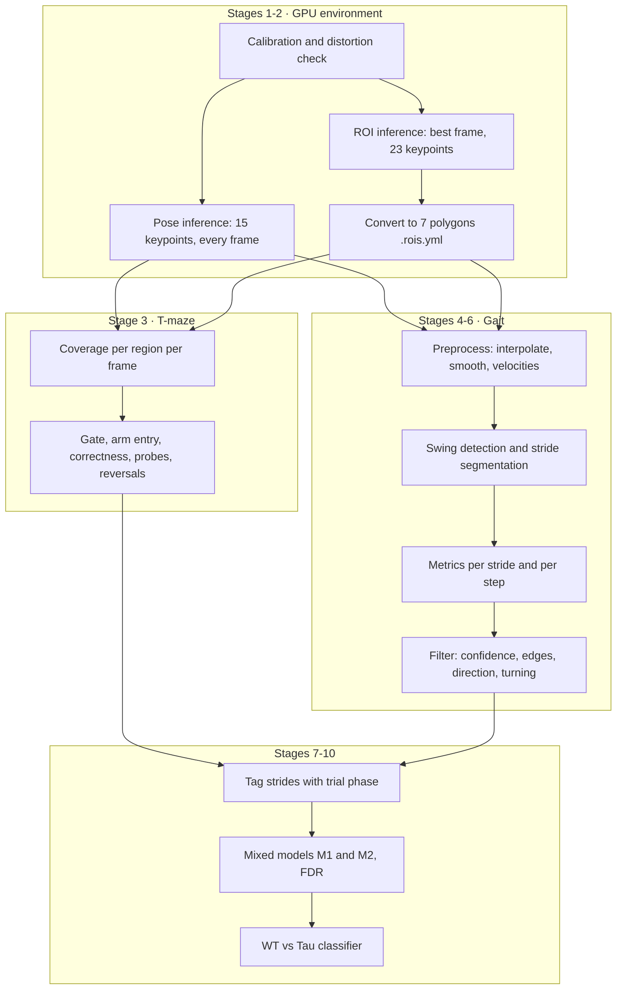

# Pipeline overview

| stage | module | reads | writes |
|---|---|---|---|
| 1 | `distortion_check` | sampled frames | distortion report, scale |
| 2 | `pose_inference`, `roi_inference`, `slp_to_yaml` | video, models | `.slp`, `.rois.yml` |
| 3 | `decision_analysis` | `.slp`, `.rois.yml`, `meta_trials.csv` | `decisions.csv`, `events.csv`, `metrics.csv` |
| 4 to 5 | `gait_extraction` | `.slp`, `.rois.yml` | `gait_per_stride.csv`, `gait_per_step.csv`, confidence table |
| 6 | `gait_filtering` | per-stride table | `gait_per_stride_filtered.csv` |
| 7 to 9 | `gait_lmm` | filtered strides, decisions | `lmm_results_all.csv`, heatmaps |
| 10 | `classification` | per-mouse features | ROC curves, feature weights |

Stages 1 to 2 need the GPU environment; everything after reads files and runs on any machine.
