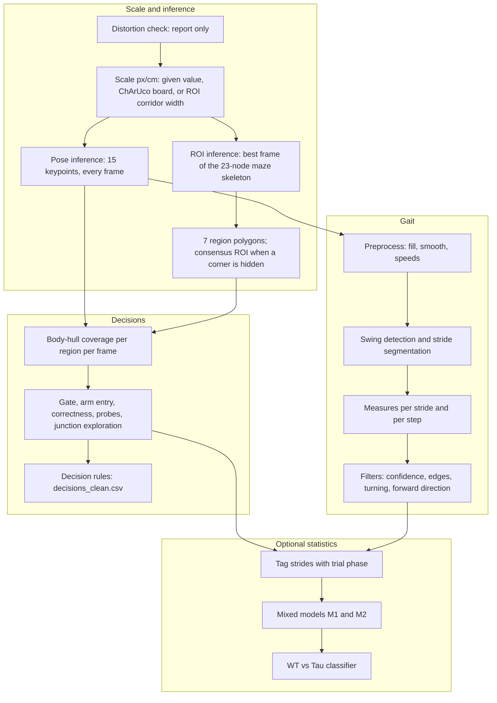

# Pipeline overview

`stride tmaze` and `stride gait` add no computation of their own: every step calls the same
stage function the rest of the package uses, so the tables are the same whichever way the stages
are started.

## Steps of `stride tmaze`

| step | module | reads | writes |
|---|---|---|---|
| `distortion_check` | `distortion_check` | frames of 6 sampled videos | `scale/distortion_check.csv` |
| `calibrate` | `scale_calibration` | the ChArUco board in view | `scale/px_per_cm.txt`, readings, QC images |
| `pose_inference` | `pose_inference` | video, pose model | `<video>.slp` |
| `roi_inference` | `roi_inference`, `roi_selection`, `slp_to_yaml` | video, ROI model | `<video>.preds.v2.best1.slp`, `<video>.rois.yml` |
| `roi_consensus` | `roi_consensus` | the ROI files of the folder | `<video>.rois.yml` for clips without one, QC overlays |
| `decisions` | `decision_analysis` | pose file, ROI file, metadata | `decisions.csv`, `events.csv`, `metrics.csv` |
| `decision_rules` | `decision_rules` | `decisions.csv` | `decisions_clean.csv` |
| `gait` | `gait_extraction`, `run_gait_extraction` | pose file, scale | the gait tables |
| `mixed_models`, `classifier` (off by default) | `gait_lmm`, `classification` | the tables above, `stats_config` | `stats/` |

`stride gait` runs `calibrate`, `pose_inference`, `gait_extraction`, `keypoint_confidence` and
`stride_filtering`, with the same modules and no ROI.

## The numbered stages of `run_all.py`

The stage-by-stage batch runner uses the stage numbers of the original study.

| stage | module | reads | writes |
|---|---|---|---|
| 1 to 2 | `run_inference` | videos, models | distortion report, `.slp`, ROI region files |
| 3 | `run_tmaze` | pose, ROI, `meta_trials_csv` | `decisions.csv`, `events.csv`, `metrics.csv`, learning cycles |
| 4 to 6 | `run_gait_extraction` | pose, ROI or `px_per_cm_override` | gait tables, confidence table, filtered strides |
| 7 to 9 | `gait_lmm` | filtered strides, decisions | `lmm_results_all.csv`, `lmm_fit_log.csv`, heatmaps |
| 10 | `classification` | per-mouse features | feature ranking, AUC table, ROC curves |

The two inference steps need the sleap-nn runtime and, in practice, a GPU; everything after reads
files and runs on any machine.
