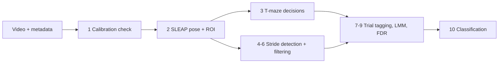

# STRIDE

**STRIDE** (Stride-level Tracking and Integrated Decision Extraction) turns one video of a mouse
running a T-maze into two phenotypes: what the animal **decided** and how it **walked**. A single
camera below the transparent maze floor records the rewarded-alternation task; SLEAP tracks a
15-keypoint pose and segments the maze into seven regions; STRIDE scores arm choices, junction
exploration and snout probes, and detects every stride to compute 16 gait metrics. The same
tables feed mixed models, FDR-corrected effect maps and a genotype classifier.

cognition choice accuracy, latency, learning curves, junction exploration, snout probes
 gait stride and step length, step width, duration, step frequency, duty factor, symmetry, body sway

## Why STRIDE

- **No extra hardware.** Gait comes from the cognitive task's own video. No treadmill, no CatWalk, no second session.
- **Gated, not trusted.** Calibration, ROI coverage, frame rate and body size are checked before any metric is reported in centimetres. A clip with no maze regions is skipped, never silently mis-scored.
- **Config-driven.** A new cohort is a new entry in `config.yaml`; every threshold and model formula lives in one file.
- **Reproducible.** Every stage writes a run manifest recording the code commit, models, parameters, inputs and environment.
- **Modular.** The gait module needs only a pose file, a straight corridor region, the scale and the frame rate. It runs on mazes that are not a T.

## Quick links

- [Installation](getting-started/installation.md) and [Quickstart](getting-started/quickstart.md)
- [Recording requirements](getting-started/recording.md): resolution, frame rate, calibration target
- [Inputs and file layout](user-guide/inputs.md) and [Outputs](user-guide/outputs.md)
- [Configuration](user-guide/configuration.md) and [Command reference](user-guide/cli.md)
- [How the decisions are scored](how-it-works/decisions.md) and [how strides are detected](how-it-works/gait.md)
- [Process a new cohort](tutorials/new-cohort.md) and [Gait on a different maze](tutorials/other-maze.md)

## Citation

> Li, Y. et al. (2026). *Dual cognitive and motor phenotyping for early detection of AD progression in APP and Tau models.* In preparation.

Software: `talmolab/STRIDE` v0.1.0, MIT license. A software DOI will be added on release.
