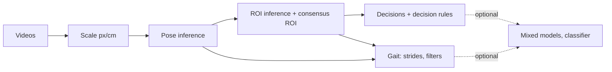

# STRIDE

**STRIDE** (Stride-level Tracking and Integrated Decision Extraction) turns one video of a mouse
running a T-maze into two phenotypes: what the animal **decided** and how it **walked**. A single
camera below the transparent maze floor records the rewarded-alternation task; SLEAP tracks a
15-keypoint pose and segments the maze into seven regions; STRIDE scores arm choices, junction
exploration and snout probes, and detects every stride to compute the stride-level gait measures.

cognition arm choice, correctness, latencies, junction exploration, snout probes
 gait stride and step measures, step width, duration, duty factor, symmetry, body sway and its phase

This is the documentation of **STRIDE 1.0.0**. Code: [talmolab/STRIDE](https://github.com/talmolab/STRIDE).
The study STRIDE was built for, and its results, are on the
[project page](https://talmolab.github.io/STRIDE-page/).

## Which STRIDE do I need?

| | For | Goes in | Comes out | Command |
|---|---|---|---|---|
| [**STRIDE T-maze**](pipelines/tmaze.md) | T-maze recordings, with your own trained pose and maze-ROI models | videos, two model paths | per-trial and per-stride CSV tables, a summary, run logs | `stride tmaze` |
| [**STRIDE Gait**](pipelines/gait.md) | any recording with pose tracking, no maze needed | videos + pose files (or a pose model), and the scale (px/cm) | per-stride, per-step and per-video gait tables | `stride gait` |

Both take the scale (px/cm) from a value you give or from a ChArUco board in view
([Scale calibration](pipelines/calibration.md), `stride calibrate`).

!!! note "The authors' own intake workflow"
    The repository also holds `lab/`, the workflow the authors use for their own recordings
    (sorting and renaming camera clips, a per-day scale check, then STRIDE T-maze). It is not
    needed to use STRIDE; it is described in [Authors' lab workflow](about/lab-workflow.md).

## How STRIDE is designed

- **One command, or one file.** Each pipeline runs from the command line alone or from one
  commented YAML file (`stride init-config`); a flag on the command line overrides the file
  ([Configuration reference](user-guide/configuration.md)).
- **Every step can be switched on or off**, and a second run does not repeat finished work.
- **No extra hardware.** Gait comes from the cognitive task's own video.
- **Your files, your names.** Any video file names work; metadata is optional.
- **Honest exits.** Anything that stops a run exits non-zero with one line saying why; videos
  that had to be left out are listed with the reason. Warnings never change a value
  ([Logs, warnings and exit codes](user-guide/provenance.md)).
- **Reproducible.** Every stage writes a run manifest recording the code version, models,
  settings, inputs and outputs.
- **Documented as computed.** The [column glossary](user-guide/outputs.md) describes every
  number exactly as the code computes it.

## Quick links

- [Installation](getting-started/installation.md), [Quickstart](getting-started/quickstart.md) and
  [Recording requirements](getting-started/recording.md)
- [STRIDE T-maze](pipelines/tmaze.md), [STRIDE Gait](pipelines/gait.md) and
  [Scale calibration](pipelines/calibration.md)
- [Inputs and file layout](user-guide/inputs.md), [Configuration reference](user-guide/configuration.md)
  and [Command reference](user-guide/cli.md)
- [Outputs and column glossary](user-guide/outputs.md)
- [How the decisions are scored](how-it-works/decisions.md) and
  [how strides are detected](how-it-works/gait.md)
- [Web tools](web-tools.md): rig checker and viewer, in the browser
- [FAQ and troubleshooting](faq.md), [Changelog](changelog.md)

## Citation

> Li Y, Ling L, Chou R, Ketterer-Sykes EB, Andrews NA, Han C, Liao C, Lee CT, Lee KF\*, Pereira TD\*.
> *Dual cognitive and motor phenotyping for early detection of Alzheimer's Disease progression in mouse models.*
> In preparation. \* corresponding authors.

Software: `talmolab/STRIDE` 1.0.0, MIT license. A software DOI will be added when the release is
archived. BibTeX: [Citation](about/citation.md).
